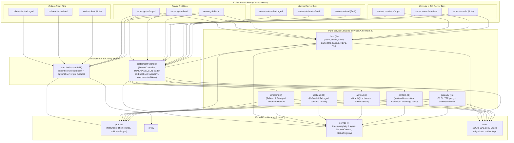
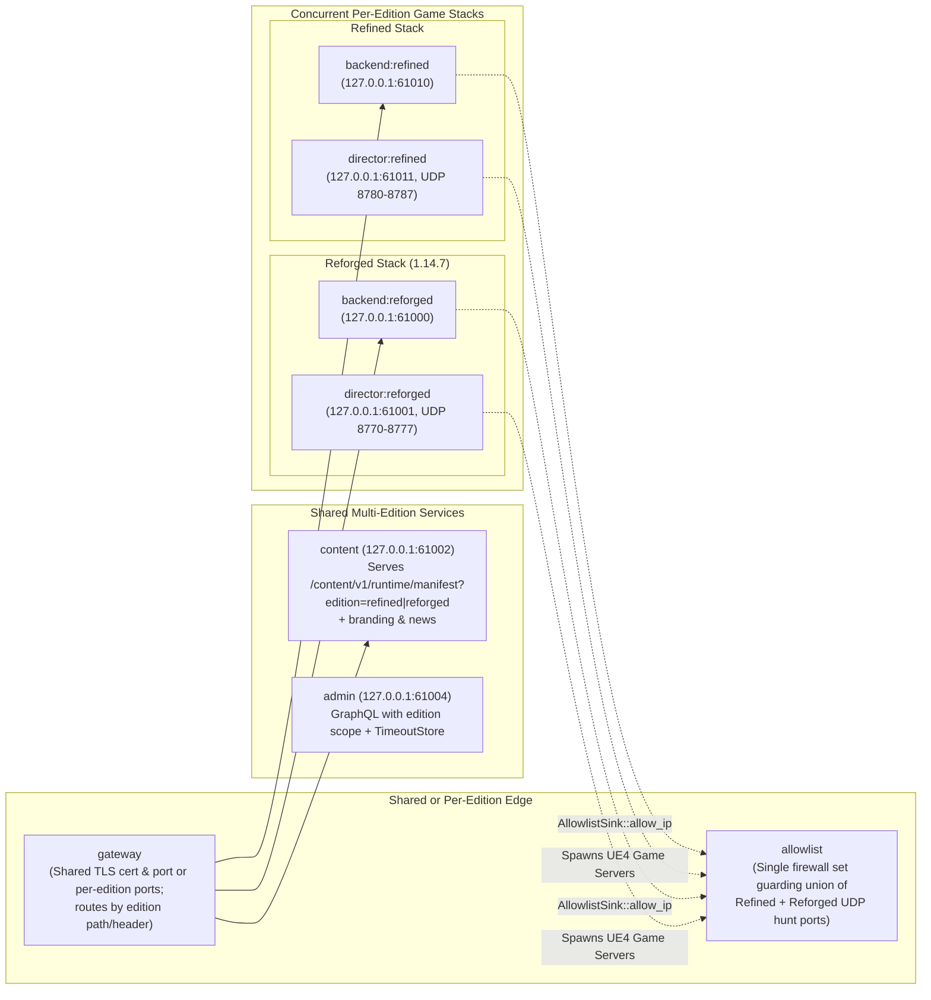

# Plan: a unified server controller, pure service libraries, concurrent editions and 12 binary crates

Draft, 2026-10-24, kept as a design record: nothing here is open work. **Superseded where it differs by RD26** in [MIGRATION_PLAN.md](../MIGRATION_PLAN.md)
(2026-10-25): this is the design the `feat/app-structure` merge (`c57f157`) was built from, kept for its reasoning.
What shipped differs: two server binaries and the launcher's two, not twelve crates; `protocol::Game` and the
`legacy` feature, not Refined and Reforged editions; the host kit's `secrets.env` and env files, not secrets the
controller makes; the backend and Director as Rustic Isles's Node processes, not Rust listeners; and each service
still runnable alone as a `reforged-host` subcommand.

This document specifies the architectural conversion of the DaintyLass Rust codebase into:
1. **Pure Library Service Crates (`services/*`)**: Converting `gateway` (including `allowlist`), `content`, `admin`, `host`, `backend`, and `director` into pure library crates (`lib.rs` only, removing standalone `src/main.rs` binaries).
2. **A Unified `ServerController` (`crates/controller`)**: Orchestrating all services in-process, supporting **concurrent `Refined` + `Reforged` execution** in a single controller instance, and **auto-generating missing secrets/certs/DB schemas on cold boot** from a single `.toml`, `.yaml`, or `.json` config file.
3. **A `tracing` + `tracing-subscriber` Logging Pipeline**: Unifying all components into a single span-attributed, secret-redacting logging bus with pluggable target layers (`TableStdoutLayer`, `LauncherGuiLayer`, `TuiRingBufferLayer`, `FileLogLayer`).
4. **12 Dedicated Binary Crates (`bins/*`)**: Providing `both` (default for releases), `refined`-only, and `reforged`-only binary crates across all four application profiles (`server-minimal`, `server-console`, `server-gui`, and `online-client`).

---

## 1. The workspace and its 12 binary crates

### 1.1 Pure library crates (`crates/*`, `services/*`, `launcher/src-tauri`)
All business logic, networking, storage, and UI components live in library crates. None of `services/*` or `launcher/src-tauri` build standalone binaries anymore; instead, every executable is a dedicated binary crate in `bins/*`:

### 1.2 The 12 binary crates (`bins/*`)

| # | Binary Crate Path | Binary Name | Edition Feature Set | Profile & Capabilities |
| --- | --- | --- | --- | --- |
| 1 | `crates/server-minimal` | `reforged-server-minimal` | `edition-both` *(Release Default)* | Headless TOML/YAML/JSON runner + cold-boot secret init + `{service:<14} \| {line}` stdout table logger. Can host Refined, Reforged, or both concurrently. |
| 2 | `crates/server-minimal-refined` | `refined-server-minimal` | `edition-refined` *(Self-Build)* | Same minimal headless runner compiled strictly with Refined support. |
| 3 | `crates/server-minimal-reforged` | `reforged-only-server-minimal` | `edition-reforged` *(Self-Build)* | Same minimal headless runner compiled strictly with Reforged support. |
| 4 | `crates/server-console` | `reforged-server-console` | `edition-both` *(Release Default)* | Full CLI subcommands + interactive console REPL + optional `ratatui` `--tui`. Supports Refined, Reforged, or both concurrently. |
| 5 | `crates/server-console-refined` | `refined-server-console` | `edition-refined` *(Self-Build)* | Full CLI + REPL + optional `--tui` compiled strictly with Refined support. |
| 6 | `crates/server-console-reforged` | `reforged-only-server-console` | `edition-reforged` *(Self-Build)* | Full CLI + REPL + optional `--tui` compiled strictly with Reforged support. |
| 7 | `bins/server-gui` | `reforged-server-gui` | `edition-both` *(Release Default)* | Tauri launcher + embedded `ServerController` + direct `LauncherGuiLayer` log stream + live Component Status Page. Supports both editions. |
| 8 | `bins/server-gui-refined` | `refined-server-gui` | `edition-refined` *(Self-Build)* | Tauri launcher + embedded `ServerController` + Status Page compiled strictly for Refined. |
| 9 | `bins/server-gui-reforged` | `reforged-only-server-gui` | `edition-reforged` *(Self-Build)* | Tauri launcher + embedded `ServerController` + Status Page compiled strictly for Reforged. |
| 10 | `bins/online-client` | `reforged-client` | `edition-both` *(Release Default)* | Player-only Tauri launcher (zero server crates linked). Connects to both Refined and Reforged servers. |
| 11 | `bins/online-client-refined` | `refined-client` | `edition-refined` *(Self-Build)* | Player-only Tauri launcher compiled strictly for Refined servers. |
| 12 | `bins/online-client-reforged` | `reforged-only-client` | `edition-reforged` *(Self-Build)* | Player-only Tauri launcher compiled strictly for Reforged servers. |

---

## 2. Concurrent Multi-Edition Execution (`Refined` + `Reforged` in One Controller)

In any of the `both` server builds (`server-minimal`, `server-console`, `server-gui`), a single `ServerController` instance can run **Refined only**, **Reforged only**, or **Refined and Reforged concurrently**.

### How each component handles concurrent editions
1. **`gateway`**:
   - Can either bind one shared public listener (routing `/content/v1/*` to `content` and dispatching backend/WebSocket traffic by edition route prefix, header `x-reforged-edition: refined|reforged`, or query parameter) **or** bind two separate public/private listeners (`[editions.reforged].gateway_port = 443`, `[editions.refined].gateway_port = 8443`) sharing the same pinned TLS certificate (`fp`) so one server cert covers both editions.
2. **`allowlist`**:
   - Runs as a **single in-process `AllowlistState` + `SyncWorker`** guarding the combined list of UDP ports from both active editions (e.g., `8770-8777` for Reforged + `8780-8787` for Refined). When a player authenticates on either edition, their IPv4 address is opened in the single `inet reforged_revival` nftables set / Windows Firewall rule.
   - In `public` mode on non-elevated Windows Desktop (`server-gui`), spawns only the lightweight `allowlist` helper with UAC (`runas`) or surfaces an elevation toggle on the Status Page; in `private` mode (Tailscale), `allowlist` is `Disabled`.
3. **`content`**:
   - Indexes runtime manifests and DLLs per edition (`.workspace/runtime/reforged/` and `.workspace/runtime/refined/`).
   - Serves `GET /content/v1/runtime/manifest?edition=refined|reforged` and `GET /content/v1/runtime/files/:edition/:name` (while defaulting to the active edition when `edition` is omitted for backward compatibility with existing 1.14.7 clients).
4. **`backend` & `director`**:
   - When both editions are enabled concurrently, `ServerController` spawns two backend instances (`backend:reforged` and `backend:refined` on distinct loopback ports, e.g., `61000` and `61010`) and two director instances (`director:reforged` and `director:refined` on `61001` and `61011` with non-overlapping UDP port ranges `8770-8777` and `8780-8787`).

---

## 3. Cold-Boot Zero-Setup Provisioning in `ServerController`

To ensure `reforged-server-minimal --config server.yaml` (as well as `server-console` and `server-gui`) works **out of the box on first boot** from a single `.toml`, `.yaml`, or `.json` file without requiring a prior `setup` step:

1. **Multi-Format Config Parsing (`TOML` / `YAML` / `JSON`)**:
   - Auto-detects format by file extension (`.toml`, `.yaml`/`.yml`, `.json`) or leading byte inspection.
   - Missing optional fields fall back to sensible defaults (`127.0.0.1` loopback upstreams, `.workspace/` data directory, default port assignments).
2. **Automatic First-Boot Secret Generation (`ensure_secrets`)**:
   - If `.workspace/secrets/secrets.env` (or inline config secrets) does not exist on boot, `ServerController` automatically generates and persists the 8 CSPRNG 32-byte hex secrets (`OPERATOR_API_KEY`, `OPERATOR_HMAC_SECRET`, `ALLOWLIST_API_KEY`, `ADMIN_API_KEY`, `DIRECTOR_SECRET`, `SESSION_SECRET`, `JWT_SECRET`, `INTERNAL_API_KEY`) and the 4096-bit RSA keypair with `0600` permissions before starting any service.
3. **Automatic TLS Certificate Generation (`cert::load_or_generate_cert`)**:
   - In `public` mode, if `cert.pem` and `key.pem` do not exist yet, generates the self-signed ECDSA P-256 certificate and logs the resulting SHA-256 fingerprint (`fp`) and ready-to-use `reforged-revival://` invite URL via `tracing::info!`.
4. **Automatic Database Migration & Preset Seeding**:
   - Runs `crates/store::drizzle::migrate` on the SQLite database files and seeds initial preset data from `preset/` if the database is empty.

---

## 4. One `tracing` + `tracing-subscriber` logging pipeline

All components emit logs via `tracing` macros (`tracing::info!`, `warn!`, `error!`, `debug!`), instrumented per component by `ServerController` (`.instrument(tracing::info_span!("component", service = service_name))`):

| Subscriber Layer | Used By | Behavior |
| --- | --- | --- |
| **`TableStdoutLayer`** | `server-minimal*`, `server-console*` (CLI mode) | Extracts the enclosing `service` span attribute, scrubs secrets via `RedactingVisitor`, and writes `{service:<14} \| {line}` atomically to `stdout`. |
| **`LauncherGuiLayer`** | `server-gui*` | Sends structured `HostLogEntry { seq, timestamp_ms, service, level, message }` over a channel directly to the Tauri `Controller`, which buffers the latest 2,000 lines and emits `host-log-batch` events to the Launcher UI. |
| **`TuiRingBufferLayer`** | `server-console* --tui` | Feeds structured log records into the `ratatui` scrollable log pane with per-service and per-level filtering. |
| **`FileLogLayer`** | `online-client*`, `server-gui*` | Writes redacted timestamped log lines to `logs/launcher.log`. |
| **`reload::Layer<Targets>`** | All targets | Enables live runtime per-service log level changes from the GUI Status Page, Console `log <service> <level>` command, or TUI keyboard shortcuts. |

---

## 5. Phases

### Phase 1: pure service libraries and `tracing` (`service-kit` + `services/*`)
1. Add `tracing`, `tracing-subscriber` (`registry`, `fmt`, `env-filter`, `reload`), `tracing-log`, and `serde_yaml` to `[workspace.dependencies]` in `Cargo.toml`.
2. Implement `ServiceContext`, `ComponentPhase`, `ComponentStatus`, `StatusReporter`, `RedactingVisitor`, `TableStdoutLayer` (`{service:<14} | {line}`), and `ChannelLogLayer` in `crates/service-kit`.
3. Convert `gateway` (and its `allowlist` submodule), `content`, `admin`, `backend`, `director`, and `host` into **pure library crates** (`lib.rs` only, removing `src/main.rs` and `src/bin/allowlist.rs`, and updating integration/parity tests to start the library servers directly in-process).
4. Add `edition-refined`, `edition-reforged`, and `edition-both` Cargo features across `protocol`, `content`, `backend`, `director`, `host`, and `launcher`.

### Phase 2: `crates/controller` (Multi-Format Config, Cold-Boot Provisioning & Concurrent Editions)
1. Create `crates/controller` implementing:
   - `ServerConfig::load` supporting `.toml`, `.yaml`/`.yml`, and `.json`, with single-edition or concurrent `Refined` + `Reforged` stack definitions.
   - Cold-boot auto-provisioning (`ensure_secrets`, `load_or_generate_cert`, and SQLite migration/preset seeding) so a fresh server starts from a single config file with zero prior `setup`.
   - `ServerController` managing in-process async service tasks, hybrid in-process `AllowlistSink`, `StatusRegistry` (`watch::Receiver<ServerSnapshot>`), per-component start/stop/restart, and reverse-order graceful shutdown.

### Phase 3: server binary crates (`server-minimal*` & `server-console*`, 6 crates)
1. Create `crates/server-minimal`, `crates/server-minimal-refined`, and `crates/server-minimal-reforged` wired to `ServerController` + `TableStdoutLayer`.
2. Implement the interactive runtime REPL (`status`, `start/stop/restart <svc>`, `invite`, `players`, `instances`, `doctor`, `backup`, `log`, `stop`) and optional `ratatui` `--tui` dashboard in `host`.
3. Create `crates/server-console`, `crates/server-console-refined`, and `crates/server-console-reforged`.

### Phase 4: client and server GUI binary crates (`online-client*` & `server-gui*`, 6 crates)
1. Split `launcher/src-tauri` into pure library modules with `server-gui`, `edition-refined`, `edition-reforged`, and `edition-both` feature gates.
2. Create `bins/online-client`, `bins/online-client-refined`, and `bins/online-client-reforged` (linking zero server crates and registering only the 34 client IPC commands).
3. Embed `ServerController` + `LauncherGuiLayer` into the launcher's `server-gui` module, add the live per-component Status Page to `bridge/types.rs` and `launcher/page`, and create `bins/server-gui`, `bins/server-gui-refined`, and `bins/server-gui-reforged`.
