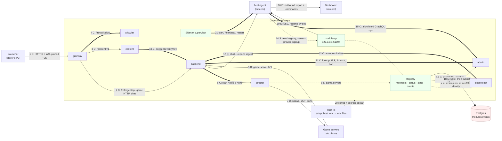

<!-- markdownlint-configure-file { "MD013": { "line_length": 120, "tables": false } } -->

# Plan: modules that share information, configuration and dependencies

Draft, 2026-10-31. Target: the controller (`rust/crates/controller`), `service-kit`, the host kit, and the two
consumers that need it first: a Discord bot and dainty-dashboard's fleet agent.

**One game.** This plan covers Dauntless 1.14.7 on rustic-isles (Mystic Paradox's implementation for the latest
version) and nothing else. Dauntless Revived's 1.4.4 stack and Mystic Paradox's 1.12 port are not modules here, and
the controller's second edition (`Refined`, which `protocol` maps to the 1.4.4 game) has no place in it.

## The problem

Every part the controller runs today is wired to the others by hand, and nothing outside the controller can see
what it is running.

| Symptom | Where |
| --- | --- |
| The start order is a fixed list: `director` → `backend` → `content` → `admin` → `allowlist` → `gateway` | `ServerController::start_all` |
| Every `spawn_*` builds the backend's and director's addresses itself from the config (`primary_backend_url`, `primary_director_url`, `backend_port`) | `spawn_admin`, `spawn_content`, `spawn_gateway` |
| The gateway reaches the allowlist through a closure over a `Mutex<Option<…>>` slot that the allowlist fills once it starts | `spawn_gateway`, `allowlist_slot` |
| The fleet agent finds admin and the backend through hard-coded loopback ports, and the host copies two secrets out of `secrets.env` into `agent.env` by hand | dainty-dashboard `docs/fleet.md` |
| A Discord bot can ask admin's `serverStatus`, which says the backend answers, not whether a game server can take a player | `docs/admin-api.md` |
| Nothing lists the game servers a controller runs. `ServerSnapshot` has `active_hunts` and `max_hunts` as two numbers | `service-kit/src/context.rs` |
| `StatusRegistry` knows a component's phase, not what it offers or needs | `service-kit/src/context.rs` |

The two motivating cases:

1. **The Discord bot must know a game server is up before it issues a key** (a signup link or an invite). Issuing
   one to a player who then can't play is the failure to prevent.
2. **The dashboard must know every game server tied to a controller**, so it can query them all, and the same for
   every controller in the fleet.

Both are the same missing piece: a place where a module says what it is, what it offers and what it needs, and where
other modules read it without knowing ports, secrets or start order.

## What a module is

| Kind | Examples | Runs | Talks to the registry through |
| --- | --- | --- | --- |
| **Built-in** | gateway, allowlist, content, admin, backend, director, the Discord bot (Rust, section 10) | in the controller's process | Rust handles (in-process) |
| **Sidecar** | fleet agent (Bun), the Node Paradox backend and Director until the port | its own process on the same host, **started and supervised by the controller** (section 9) | the **local module API** (loopback HTTP) |
| **Remote** | another controller in the fleet | another host | its own agent, which reads its local module API and reports to the dashboard |

A module is identified by a stable **module id** (`director-reforged`, `discord-bot`, `fleet-agent`). The built-in
ids are the component names `start_component` already takes, so the console's `restart content` and the GUI's
status page keep working.

## Design in one picture

```text
                       ┌──────────────────────── controller process ─────────────────────────┐
                       │                                                                     │
                       │   ModuleRegistry (crates/modules)                                   │
                       │   ├─ manifests      what each module is, provides, requires         │
                       │   ├─ status         phase per module (today's StatusRegistry)       │
                       │   ├─ state          watch channels:  game.servers, game.availability│
                       │   ├─ commands       request handles: accounts.invites, ...          │
                       │   └─ events         broadcast:       GameServerUp/Down, ...         │
                       │        ▲          ▲            ▲                                    │
                       │  director    backend    admin, content, gateway, discord-bot         │
                       │                                                                     │
                       │   module-api  127.0.0.1:61007  (bearer token per module, scoped)    │
                       │   sidecar supervisor: spawns, heartbeats, restarts, captures logs   │
                       └──────────────────────────────▲──────────────────────────────────────┘
                                                      │ loopback only            events ──▶ Postgres
                          ┌───────────────────────────┼─────────────────────────┐            (modules.events)
               Node backend / Director        fleet-agent ──outbound──▶ dashboard
               (sidecars until the port)     (sidecar)
```

Three channels, each for one kind of sharing:

- **State** (what is true now): a `tokio::sync::watch` value per capability. Providers publish, consumers read the
  latest and can wait for a change. The game-server directory and availability are state.
- **Commands** (do something, get an answer): a typed request handle per capability (`mpsc` with a `oneshot`
  reply). Issuing an invite is a command.
- **Events** (something happened): one `tokio::sync::broadcast` bus with typed topics. A game server going down
  is an event.

Configuration and secrets are not a fourth channel at runtime: they are resolved once, at start, and handed to each
module (section 5).

## 1. The manifest

Every module has a manifest. Built-in modules declare theirs in code; sidecars get theirs from the host's
configuration, **never from the sidecar itself**, because what a module may read is the host's decision.

```rust
pub struct Manifest {
    pub id: ModuleId,                  // "director-reforged"
    pub kind: ModuleKind,              // BuiltIn | Sidecar | Remote
    pub provides: Vec<CapabilityRef>,  // "game.servers@1"
    pub requires: Vec<Requirement>,    // { cap: "game.availability@1", need: Need::Ready }
    pub config_section: Option<&'static str>, // "[modules.discord-bot]"
    pub secrets: Vec<&'static str>,    // names in secrets.env it is given, nothing else
}

pub enum Need {
    Ready,    // start only after a provider is Ready; stop if every provider goes away
    Present,  // a provider must exist, it may still be starting
    Optional, // use it when there, degrade without it
}
```

A **capability** is a named, versioned contract (`game.servers@1`). The version is the contract's, not the
crate's: a field added in a compatible way keeps `@1`; a field removed or changed in meaning is `@2`, and the
provider serves both until no consumer asks for `@1`.

## 2. The registry

`ModuleRegistry` replaces `StatusRegistry` and keeps its whole API: `service_context`, `subscribe`, `snapshot`
and `ServerSnapshot` stay, so the console REPL, the TUI and the GUI status page change nothing. What it adds:

- `register(manifest)` and `manifests()`.
- `provide::<C>(handle)` / `get::<C>() -> Option<C::Handle>`: a typed slot per capability, keyed by the capability
  type. A built-in module receives the handles for its `requires` in its `ServiceContext`, so it never looks one up
  by name.
- `events() -> broadcast::Receiver<Event>`.

No `dyn` async traits: a capability's handle is a concrete, cloneable struct wrapping a `watch::Receiver` or a
request sender. That keeps it free of `async_trait`, cheap to clone into a request handler, and testable with a
handle a test builds itself.

The types live in a **new crate, `crates/modules`**, so the bot, the agent's Rust successor or a game module can
depend on the contract without the controller. It ports nothing from DR or Paradox, so it is **MIT**, like
`controller` and `admin`. Adding it to `[workspace]` and `[workspace.dependencies]` is a seam change for the
integration pass.

## 3. Capabilities, version 1

| Capability | Kind | Provider | Consumers | What it holds |
| --- | --- | --- | --- | --- |
| `game.servers@1` | state | director | admin, fleet agent, dashboard, bot | Every game server: `id`, `kind` (hub, hunt, training), `address`, `udpPort`, `phase` (starting, ready, draining, down), `players`, `capacity`, `title`, `lastHeartbeatMs` |
| `game.availability@1` | state | the controller, derived | bot, admin | `accepting: bool`, `reason` code when not (`backend_down`, `director_down`, `no_game_server`, `maintenance`), `freeSlots` (hunt slots, informational) |
| `service.endpoints@1` | state | the controller | admin, content, gateway, backend | The loopback URLs of the backend, director, content and admin. Replaces each `spawn_*` working them out from the config |
| `accounts.invites@1` | command | backend | bot, admin | `create(uses, expires) -> code`, `revoke(code)`; the same calls as `CreateInvite` and `DELETE …/InviteCode/:code` |
| `accounts.verifyKey@1` | command | backend | content | What content's `GetUserInfo` call answers today: the account behind a key, or its ban. Content keeps its short cache |
| `firewall.allow@1` | command | allowlist | gateway | Open the game ports to a player's address after login. Replaces the `InProcessSink` closure over a mutex slot |
| `players.lookup@1` | command | backend | admin, bot | What admin's `player(username)` resolves today |
| `server.identity@1` | state | the controller | everyone | Server name, mode, public host, game version (1.14.7), invite URL, certificate fingerprint. Never a secret |
| `dashboard.signup@1` | state | the fleet agent (a sidecar provider), from the dashboard's settings | Discord bot | `enabled: bool`, `url` of the dashboard's account creation page, `updatedAtMs`. Absent or older than its TTL reads as disabled |

**"Up" is defined once, in `game.availability`.** The server is accepting when the backend and director are
`Ready` and the hub game server has a heartbeat younger than its TTL: a player who logs in lands somewhere. Free
hunt slots don't gate it; `freeSlots` is reported beside it so a reader can say "up, but every hunt is taken". A
game server whose heartbeat is older than the TTL is `down` in `game.servers` even if the director never said so.
Every consumer reads the same answer instead of reinventing it.

Reasons are **codes, not sentences**: the bot and the dashboard translate them (the launcher's catalog rule applies
to anything a player reads).

## 4. Events

One bus, typed topics, **kept in Postgres**:

| Event | Emitted by | Used for |
| --- | --- | --- |
| `ModulePhaseChanged { id, from, to }` | registry | status pages, the agent's report, restarts of dependents |
| `GameServerUp` / `GameServerDown { id, reason }` | director, the TTL sweep | the bot announcing outages, the dashboard's live hunt list |
| `AvailabilityChanged { accepting, reason }` | controller | the bot holding or releasing queued key requests |
| `InviteIssued { by }` / `InviteRevoked` | backend | audit in the dashboard (no code in the event) |
| `PlayerJoined` / `PlayerLeft { userId, gameServer }` | backend | counts in `ServerSnapshot`, the dashboard |
| `DiscordKeyRequested { discordId, outcome }` | Discord bot | audit: who asked, and whether they got a signup link, a login URI or a reason (never the code) |

**Storage.** Events go in the backend's Postgres (RD15), in their own schema so the backend's tables stay its own.
Neither exists yet: `store` is still SQLite until RB3 moves it to `PgConnection`, and the host kit sets up only
MongoDB until RB14 adds the managed Postgres. **The event store waits for both**; there is no interim SQLite table to
migrate later. Until then the bus runs in memory only, and nothing that needs history ships to hosts.

```sql
create schema modules;
create table modules.events (
  seq        bigint generated always as identity primary key,
  at         timestamptz not null default now(),
  topic      text not null,            -- 'game.server.down'
  source     text not null,            -- module id
  payload    jsonb not null,           -- the typed event, serde; never a secret or a code
  dedupe_key text,                     -- set by providers that may retry
  unique (source, topic, dedupe_key)
);
create index on modules.events (topic, seq);
create index on modules.events (at);
```

- **Write first, then publish.** The registry inserts the event (on `store`'s blocking pool), takes `seq`, and only
  then sends it on the in-process `broadcast`. A receiver that lags or restarts catches up from the table, so the
  bus can stay lossy in memory without losing anything.
- **`seq` is the event id** everywhere: the SSE stream's `id:`, `Last-Event-ID` resume, and the agent's cursor. Resume
  reads `where seq > $1 and topic = any($2) order by seq`, so there is no "too old" case inside the retention.
- **Retention** is a `host.toml` setting (`modules.event_retention_days`, default 90), enforced by a daily delete
  by `at`. Audit events (`InviteIssued`, `DiscordKeyRequested`) can get a longer one of their own.
- The migration is `store`'s, so it goes through the store seam's owner (section 5.1 of the plan), not this row.
- State is still the source of truth for "what is true now": a consumer reads the state capability on start, then
  follows events from the `seq` it read it at.

## 5. Configuration and secrets

**Configuration** stays on the path it has: one file the host writes, rendered for each module.

- A module's own settings are a section in the controller's config, `[modules.<id>]`, and in `host.toml` for the
  host kit (a field in `HostConfig`, a snake_case key in `hosttoml.rs`'s table, a `setup` option where a host should
  choose it), per AGENTS.md's rule for new settings.
- What every module may know (`server.identity`) is a capability, not a copy pasted into each section.
- A built-in module gets its section deserialized into its own config struct, as `spawn_*` does today.
- A sidecar gets an env file rendered by setup, as every service does (`--env-file`), holding its section, the
  module API's URL and its token. **`DAINTY_` joins `SERVER_PREFIXES`** in `services/host/src/services.rs` so a
  stale shell variable never reaches it.

**Secrets** go only where a manifest names them.

- A module's `secrets` list is the only way to receive one; the controller passes those names and nothing else.
- **The module API never returns a secret.** A sidecar that needs one (the fleet agent's admin key) gets it in its
  rendered env file, which ends the hand copy in `fleet.md` without putting a key on the wire.
- Each sidecar's module token is a new `secrets.env` entry (`MODULE_TOKEN_<ID>`), made once, never logged, rotated
  by `reforged-host module rotate <id>`.

## 6. Dependencies and start order

The controller sorts manifests topologically on `requires` and starts in that order, which reproduces today's
order for the built-in set (a test pins it). A cycle, or a `Ready`/`Present` requirement nothing provides, stops the
start with the module ids named.

At runtime:

- A module whose `Ready` requirement loses its last provider moves to `Starting` with a detail naming what it waits
  for, instead of failing requests one by one. It returns to `Ready` when a provider does.
- `restart <module>` restarts dependents only when the restarted module's handles cannot be reused (a command
  handle's channel closed). State handles survive a provider restart, since the controller owns the `watch` sender
  and gives it to the next instance.
- Shutdown stays reverse start order.

## 7. The local module API (sidecars)

A built-in module, `module-api`, on `127.0.0.1:61007` (the next free port after 61005 and before the agent's ingest
relay on 61009; confirm against the host kit's port table). JSON as the other services write it, camelCase.

| Route | Scope needed | Answer |
| --- | --- | --- |
| `GET /modules/v1/self` | any token | The caller's manifest, its granted capabilities, and its config section |
| `GET /modules/v1/registry` | `registry.read` | Every module's id, kind, phase and what it provides. No configuration |
| `GET /modules/v1/state/{capability}` | that capability | The current value |
| `GET /modules/v1/events?topics=&after=` | each topic's capability | Server-sent events from Postgres, then live; resumable by `Last-Event-ID` (the `seq`) |
| `POST /modules/v1/call/{capability}/{operation}` | that capability | One command. Operations are a fixed list per capability, as the fleet agent's `ops.ts` is for GraphQL |
| `PUT /modules/v1/state/{capability}` | `provide:{capability}` | A sidecar **provides** a state capability (the agent's `dashboard.signup`). Validated against the capability's type; the controller owns the `watch` sender |
| `POST /modules/v1/self/heartbeat` | any token | The sidecar's liveness, which section 9 turns into its phase |

- **Bearer token per module**, compared in constant time (`subtle`). The scopes are the host-configured
  `requires`; a token without a scope gets 403, an unknown token 401.
- **Loopback only.** Any non-loopback bind stops the start, as admin's does. The gateway never forwards to it, and
  `/modules` joins `HOST_ONLY_PREFIXES` in `services/gateway/src/policy.rs` with a test, so a later routing change
  can't expose it by accident.
- Rate limited per token, bodies capped, SSE connections per token capped.
- It is a trust-boundary component (RX3): its fuzz target in `rust/fuzz/` (the route and query parser, the call
  body) and `docs/security/module-api.md` land with its code.

## 8. Across controllers

The fleet keeps its shape (`dainty-dashboard/docs/fleet.md`): the agent dials out, nothing dials in, each
controller's secrets stay on it. What changes:

- The agent is a sidecar with the scopes `registry.read`, `game.servers@1`, `game.availability@1` and
  `provide:dashboard.signup`. It reads its controller's module API instead of hard-coded ports.
- The dashboard sends its account-creation setting (enabled, and the page's URL) down the agent's existing event
  stream whenever it changes and on every connect; the agent `PUT`s it as `dashboard.signup`.
- Its 15-second report gains `registry` (modules and phases) and `gameServers` (the `game.servers` value). Both are
  new fields in `@dainty/fleet`'s protocol, optional so an older agent still reports.
- The dashboard's own controller runs the same agent code path in-process, so "every game server tied to the
  controller" is one query whether the controller is local or remote.
- Commands from the dashboard stay the agent's allowlist; the module API's operation list is the second gate on
  the controller itself.

No federation between controllers' registries: the dashboard is the only place the fleet is put together, as now.

## 9. Sidecars are started by the controller

Every sidecar is a child of the controller, so the controller is the one place a host sees what runs.

- `[modules.<id>]` names the program and its arguments (`command = ["bun", "apps/agent/src/main.ts"]`, or a
  binary path), its working directory, and `enabled`. A sidecar listed without `command` is a configuration error,
  not an external process the controller trusts on sight.
- Started after the built-in modules it requires are `Ready` (section 6), with the host kit's process contract: the
  environment cleared of anything in `SERVER_PREFIXES`, its rendered env file passed (`--env-file` or the
  equivalent the program takes), in the controller's process tree (the Windows job object, the Linux process group),
  so nothing survives the controller.
- **Phase:** `Starting` from spawn until its first authenticated `heartbeat`; `Ready` while heartbeats arrive
  (every 10 s, three missed is `Failed`); `Stopped` on a clean exit.
- **Restarts** with backoff (1 s doubling to 60 s, reset after 10 minutes up), counted in `ComponentStatus.restarts`,
  each one a `ModulePhaseChanged` event. Five failures inside 10 minutes stop retrying and leave it `Failed` with the
  last exit code and stderr line in `detail`.
- **Logs:** stdout and stderr are read line by line into `tracing` under the module's span, through the same
  redaction, so they show in the table, the TUI and the GUI like a built-in's.
- **Stop:** a polite signal (Ctrl+Break on Windows, `SIGTERM` on Linux), 10 s, then kill; in reverse start order with
  the rest.
- `restart <id>`, `stop <id>`, `start <id>` in the REPL and the GUI work for sidecars as for built-ins.

## 10. The Discord bot

A built-in module in Rust: `services/discord-bot`, a library crate the controller runs in-process when
`[modules.discord-bot] enabled = true`. Being built-in, it uses the handles directly and needs no module token.

- **Library:** `twilight` (gateway, http, model; no cache needed for slash commands), added to
  `[workspace.dependencies]` by the integration pass. `serenity` is the alternative if a framework is wanted later.
- **Settings:** `[modules.discord-bot]` in `host.toml`: `application_id`, `guild_ids`, `moderator_role_ids`. The bot
  token is a secret (`DISCORD_BOT_TOKEN` in `secrets.env`, `SECRET_KEYS`), set by
  `reforged-host setup --discord-bot-token` reading stdin, never a `host.toml` field and never logged.
- **Text:** every reply comes from a catalog with `en` and `pt-BR`, chosen by the interaction's `locale`, with
  `{placeholders}` for names and URLs. Reason codes from `game.availability` map to catalog keys.
- **Licensing:** MIT only if nothing is rewritten from DR's `UndauntedDiscordBot`. If its commands port DR's (the
  `/status`, `/player`, `/hunts` sketch in `docs/admin-api.md` follows it), the crate is AGPL with a NOTICE line.

### `/key`: a key only when the server can take the player

The bot requires `game.availability@1` (Ready), `accounts.invites@1` (Ready), `server.identity@1` (Ready) and
`dashboard.signup@1` (Optional). Every reply is **ephemeral** (Discord's ephemeral flag: only the member who ran
the command sees it).

1. Read `game.availability`. **Not accepting** → reply with the translated reason ("No game server is up right now,
   try again later"), record `DiscordKeyRequested { outcome: "unavailable" }`, stop.
2. Read `dashboard.signup`.
   - **Account creation enabled on the dashboard** → reply with the link to its account creation page and the
     short instructions from the catalog (create the account there, install the launcher, sign in). Outcome
     `signup_link`. No invite is made here: the dashboard handles registration.
   - **Disabled, absent or stale** → call `accounts.invites.create(uses: 1, expires: 30 min)` and reply with the
     login URI built from `server.identity` and the new code
     (`reforged-revival://join?v=2&mode=public&host=..&port=..&fp=..&code=..&name=..`, or the `v=1` private form).
     Outcome `login_uri`.
3. **The availability check is repeated inside `create`.** The backend's provider reads `game.availability` before
   it makes the code and answers `Unavailable(no_game_server)` when the state changed since step 1; the bot then
   replies as in step 1. The bot's read picks the message; the command's check is the guarantee.
4. Per Discord id: one live code at a time (a second `/key` inside the expiry returns the same URI, still
   ephemeral), and at most five requests per 15 minutes.

The invite code and the URI never go to a channel, a log line or an event; the event records only the outcome.

## 11. How the standard modules interact

Every interaction between the standard modules, with the channel each should use.



`D` data plane (`-->`), `S` state (`-.->`), `C` command (`==>`), `E` event (`--o`).

### Which channel for which kind of interaction

| Kind | Use | Why |
| --- | --- | --- |
| Player and game traffic | **Direct sockets.** The registry hands out addresses at start (`service.endpoints`) and is never on the path | Latency, the existing wire contracts, and the gateway's policy are all per request; a broker in between adds a hop and a failure mode for nothing |
| A fact other modules need now | **State**: a `watch` in process, `GET /state/...` for a sidecar | Readers get the latest value without asking its owner, the value survives the owner's restart, and no one polls |
| An action that needs an answer | **Command**: a request handle in process, `POST /call/...` for a sidecar. The provider rechecks its own preconditions | One owner decides; the recheck closes the gap between a reader's look and the action |
| Something happened, or history | **Event**, written to Postgres, then published | Audit and catch-up after a restart; nothing waits on a consumer |
| Configuration and secrets | **At start only**: the rendered env file, or the module's section in `ServiceContext` | No runtime API can leak a secret it never holds; a change is a restart, as today |
| Lifecycle | **Registry and supervisor**: phase in `ServiceContext`, heartbeats for sidecars | One place shows and controls everything that runs |
| An upstream contract (Paradox's HTTP, the game-server API, the dashboard's ingest API) | **Stays HTTP**, wrapped as a capability provider where a Rust module consumes it | The contract keeps its byte-for-byte shape; the backend port swaps the provider, and no consumer changes |

### Each interaction, today and in the plan

| # | From → to | What | Today | Plan |
| --- | --- | --- | --- | --- |
| 1 | launcher → gateway | Everything a player sends | Pinned TLS (public) or Tailscale HTTP | Unchanged |
| 2 | gateway → backend | Launcher API, game HTTP, chat WebSocket | Proxy; address worked out in `spawn_gateway` | Proxy; address from `service.endpoints` |
| 3 | gateway → content | Runtime manifest and files, branding, news | Proxy | Unchanged; address from `service.endpoints` |
| 4 | gateway → allowlist | Open the game ports after login | `InProcessSink` closure over a `Mutex<Option<…>>` slot | `firewall.allow@1` handle in `ServiceContext` |
| 5 | game servers → backend | Game-server API, its key, loopback | HTTP | Unchanged (a game contract) |
| 6 | backend → director | Start and stop hunts | HTTP, `director_url` in the backend's config | HTTP kept (Paradox's contract), URL from `service.endpoints` |
| 7 | director → game servers | Processes and UDP ports | Spawns | Unchanged |
| 8 | director → registry | Which game servers run, their heartbeats | Two counters in `ServerSnapshot` | `game.servers@1` state, TTL sweep in the controller |
| 9 | registry → admin | Availability, endpoints, identity | Admin's config holds the backend and director URLs and the hunt limit | State |
| 10 | content → backend | Is this key an account, is it banned | HTTP `GetUserInfo`, cached | `accounts.verifyKey@1`; an HTTP adapter until the Rust backend |
| 11 | admin → backend | Lookups and moderation | Signed `/admin/v1` HTTP | Same calls; commands after the backend port |
| 12 | bot → backend | Single-use invite | — | `accounts.invites@1`, rechecks availability |
| 13 | registry → bot | Availability, identity, dashboard signup | — | State |
| 14 | agent → module API | Registry, game servers, availability; provides `dashboard.signup` | Hard-coded loopback ports | `GET` / `PUT /modules/v1/state/...` with its token |
| 15 | agent → admin | Allowlisted GraphQL operations | Admin key copied into `agent.env` by hand | Unchanged calls; key rendered into its env file by setup |
| 16 | agent → dashboard | Status report every 15 s, commands down | Outbound SSE and POSTs | Unchanged; report gains `registry` and `gameServers` |
| 17 | backend → agent | Chat and reports | Ingest relay on 61009 | Unchanged (the dashboard's contract) |
| 18 | every module → event store | What happened | — | Written to `modules.events`, then broadcast |
| 19 | module API → agent | Event stream | — | SSE, resumable by `seq` |
| 20 | host kit → controller | Settings and secrets | `host.toml` and `secrets.env` rendered to env files | Unchanged, plus `[modules.*]` and module tokens |
| 21 | supervisor → agent | Run it | The host runs it by hand | Started, watched and restarted by the controller |

The rule underneath: **the registry carries facts, decisions and history; it never carries a player's packets
or a secret.**

## Walkthroughs

### The dashboard lists every game server of every controller

1. Each agent reads `GET /modules/v1/state/game.servers` and includes it in its report.
2. The dashboard stores the last report per controller, as it does with status today, and the Overview and a
   controller's page read it. A page view still costs nothing on the controllers.
3. To query one game server, the dashboard sends a command naming its `id`; the agent resolves the id through the
   same value.
4. Admin's GraphQL gains `gameServers` and `availability` (new fields, existing ones untouched), read from the
   registry instead of asked of the director.

## Things that must not change

- The gateway is the only listener off loopback. The module API is loopback only and host-only at the gateway.
- `/reforged/api`, admin's existing GraphQL fields and their answers, invites and the certificate `fp` are
  untouched. New admin fields are additions.
- Every service still reads one env file; the host kit still writes them all. No setting becomes a variable the host
  is told to export.
- `start_component` names, `ServerSnapshot` and its JSON stay as they are; the status page, REPL and TUI keep
  working unchanged.
- Secrets are never logged and never answered by an API.

## Rows

Each row is one agent, one worktree and branch, as RD18 describes. MS1 is the seam and lands first.

| Row | What | Owns | Needs |
| --- | --- | --- | --- |
| **MS1** | `crates/modules`: `ModuleId`, `Manifest`, `CapabilityRef`, `Need`, the v1 capability value types, `Event`, `ModuleRegistry` (wrapping today's `StatusRegistry`), with every v1 capability registered as a stub. Seam changes reported to the integration pass: the workspace members and dependency | `crates/modules` | — |
| **MS2** | Controller: manifests for the built-in modules, the topological start replacing the fixed list (a test pins today's order), `service.endpoints`, `server.identity` and `firewall.allow`, `ServiceContext` carrying required handles | `crates/controller` | MS1 |
| **MS3** | The director publishes `game.servers` with heartbeats; the controller's TTL sweep and `game.availability`; the events for both | `services/director`, `crates/controller` (availability module only) | MS2. If director rows are still gated (RD17), an adapter over the director's status endpoint instead |
| **MS4** | Admin: endpoints from `service.endpoints`, `gameServers` and `availability` fields, `schema.graphql` regenerated, `docs/admin-api.md` | `services/admin` | MS3 |
| **MS5** | `module-api` service: routes, tokens, scopes, SSE with resume, limits; `/modules` in the gateway's host-only list with its test; fuzz target; `docs/security/module-api.md` | new `services/module-api`, one line in `gateway/src/policy.rs` (reported, gateway owner merges) | MS2 |
| **MS6** | Host kit: `[modules.*]` in `host.toml` and `hosttoml.rs`, sidecar env rendering, `MODULE_TOKEN_*` in `SECRET_KEYS`, `DAINTY_` in `SERVER_PREFIXES`, `module rotate`, settings rows in `docs/hosting.md`, `hosting-linux.md`, `hosting-docker.md`; a Compose service template for a sidecar | `services/host`, `docker/` | MS5 |
| **MS7** | `accounts.invites`, `accounts.verifyKey` and `players.lookup` providers in the backend, with the availability check inside `create` | `services/backend` | MS3. Gated by RD17 like the rest of the backend; until then a sidecar adapter over the Node backend's host-only routes |
| **MS8** | dainty-dashboard: the agent as a sidecar, `registry` and `gameServers` in `@dainty/fleet`'s report, the account-creation setting pushed to agents and provided as `dashboard.signup`, the dashboard's game-server views, `fleet.md` | dainty-dashboard repo | MS5, MS6, MS12 |
| **MS9** | Discord bot as a built-in Rust module (section 10): `/key`, `/status`; its catalog in `en` and `pt-BR`; the token in `secrets.env` and its `setup` option; replaces the sketch in `docs/admin-api.md`. `twilight` reported for `[workspace.dependencies]` | new `services/discord-bot` | MS3, MS6, MS7, MS11 |
| **MS11** | `modules.events` in Postgres: the migration (through the `store` owner), write-then-publish in the registry, resume by `seq`, retention | `crates/modules` (event store), one migration reported to the `store` owner | MS1, **RB3** (`store` on Postgres), **RB14** (the host kit's managed Postgres) |
| **MS12** | Sidecar supervision (section 9): spawn, env, process tree, heartbeats, backoff, log capture, REPL and GUI commands | `crates/controller` (sidecar module only) | MS5, MS6 |

MS4, MS5 and MS3's follow-ups can run side by side once MS2 is merged. Nothing here edits `MIGRATION_PLAN.md`; the
integration pass adds the rows and the decisions below.

## Decisions to record

- Capabilities are concrete handles over `watch`, request channels and `broadcast`, not `dyn` traits.
- A sidecar's manifest and scopes come from the host's configuration, never from the sidecar.
- The module API never returns a secret; secrets reach a sidecar only in its rendered env file.
- "Up" is `game.availability`, computed once by the controller, and a command that depends on it checks it again
  itself.
- Unavailability reasons are codes; the reader translates them.
- `crates/modules` is MIT.
- 2026-10-31: the Discord bot is Rust, a built-in module. `/key` sends the dashboard's account creation link when
  the dashboard has account creation on, otherwise a single-use login URI, ephemerally, to the member who asked.
- 2026-10-31: the controller starts and supervises every sidecar.
- 2026-10-31: events are kept, in Postgres (`modules.events`), written before they are published.
- 2026-10-31: the server is up when its hub game server is running. Free hunt slots are reported, not required.
- 2026-10-31: the event store waits for Postgres (RB3, RB14); no interim SQLite store.
- 2026-10-31: the Discord bot waits for the event store (MS11), so it ships with its audit, after the backend
  cutover.
- 2026-10-31: one game, 1.14.7 on rustic-isles. No Dauntless Revived 1.4.4 modules and no Mystic Paradox 1.12
  modules, so nothing here is per edition. Importing and converting a legacy database is kept, outside this plan.

## Open questions

1. **A hub started on demand.** If the Director starts the hub only when the first player connects, "the hub is
   running" becomes "the Director is ready to start one". MS3 checks how the Director behaves before fixing the rule
   in code.
