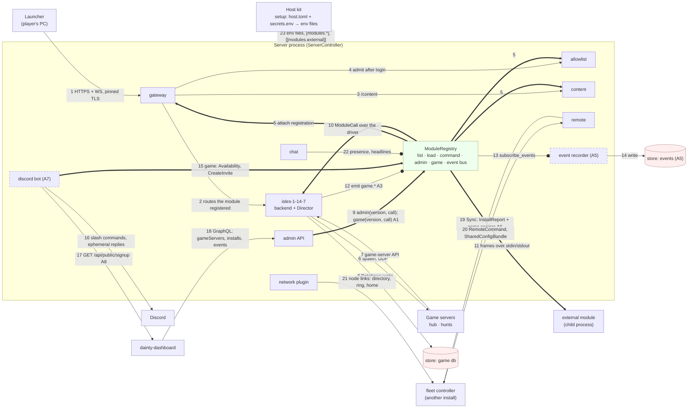

<!-- markdownlint-configure-file { "MD013": { "line_length": 120, "tables": false } } -->

# Plan: modules that share information, configuration and dependencies

Draft, 2026-11-01, reworked against `plan` (`8ea66dd`). The first draft (`8e4d192`) was written against `main` and
proposed a registry, capabilities, a loopback module API and a sidecar supervisor that `plan` already has in another
form. This version keeps what exists, cuts what duplicates it, and lists only the additions.

**One game.** Dauntless 1.14.7 on rustic-isles (`isles-1-14-7`, from `modules/rustic-isles`) and nothing else. No
Dauntless Revived 1.4.4 or Rustic Isles 1.12 modules, so nothing here is per edition.

**Words.** A *server* is one DaintyLass install: a `ServerController` (`crates/controller/src/controller.rs`) with its
`ModuleRegistry` (`crates/controller/src/registry.rs`). The *fleet controller* is the install with
`[remote] role = "controller"` (DD27, `docs/remote-management.md`). dainty-dashboard calls a server a "controller";
this doc doesn't.

## The two motivating cases

1. **The Discord bot must know the server is up before it issues a key.** "Up" means the hub game server is running.
   `/key` replies with the dashboard's signup link when the dashboard allows signups, otherwise with a single-use login
   URI, and only the member who asked sees either.
2. **The dashboard must list every game server of every server**, so it can show and query them all.

## What `plan` already has

| Need | Already there | Where |
| --- | --- | --- |
| A module, its identity and what it needs | `GameModule` (game or plugin, keyed by `GameVersion`), `ModuleManifest`, `Registrar` / `Registration` (routes, UDP ports, content, commands, emitted and subscribed events, admin actions, config sections) | `crates/module-api/src/module.rs`, `manifest.rs`, `registrar.rs` |
| Built-in services as parts of one process | `Module` started in order, stopped in reverse, phase in `StatusRegistry`; gateway, allowlist, content, admin, chat, network, remote are constructors | `crates/controller/src/controller.rs`, `modules.rs` |
| A registry of loaded modules | `ModuleRegistry`: `list`, `info`, `load`, `unload`, `restart`, `command`, `admin(version, call)`, `for_invite` | `crates/controller/src/registry.rs` |
| Compiled-in plugins that serve modules | `CorePlugin` with `CoreCapability` (routes, UDP ports, content, commands, events, admin actions, config, chat, network) | `module-api/src/module.rs` |
| Events | One `broadcast` bus on the registry: `HostCall::Emit` from a module, `ModuleRegistry::emit` from the host (`server.ready`), delivered to subscribers through `GameModule::event`, readable by anyone through `subscribe_events` | `registry.rs` (`publish`), `module.rs` (`Event`, `EventName`) |
| Out-of-process modules ("sidecars") | `[[modules.external]]` in `host.toml`; `ChildModule` checks the SHA-256, runs the executable with only `system_environment`, speaks length-prefixed JSON frames (`Hello`/`Welcome`, `ModuleCall`/`ModuleAnswer`), kills its process tree on unload, and the registry shows a dead child as `Failed` | `module-api/src/host.rs`, `frame.rs`, `child.rs`; `crates/hostkit/src/hostconfig/modules.rs`; `docs/security/module-host.md` |
| Per-module configuration | `[modules.<id>.<section>]` laid over registered defaults into `ModuleConfig.sections`; `ModuleRegistry::update_settings`; ports placed by `PortBook` into `ModuleConfig.ports` | `registry.rs`, `ports.rs`, `hostconfig/modules.rs` |
| Secrets for built-in services | Each built-in reads its own env file that `setup` writes from `host.toml` and `secrets.env` (`SECRET_KEYS`) | `crates/hostkit/src/hostconfig.rs`, `controller/src/modules.rs` |
| Moderation across modules | `AdminRequest` (kick, ban, unban, lift timeout, lookup) routed to the player's game; admin GraphQL `modules`, `loadModule`, `unloadModule`, `restartModule` | `services/admin/src/modules.rs`, `module_control.rs`, `schema.graphql` |
| The hub's readiness | `DedicatedServers::hub_status()` → `LiveHubStatus { ramsgate: Option<LiveHub { ready, host, port }>, .. }` from the Director's `GET /api/hub-status` | rustic-isles `crates/isles-core/src/areas/matchmaking/deploy.rs` |
| Every game server on one server | The Director's `GET /api/instances`: city (hub), hunt, dojo, tutorial, with players. Admin parses it (`input::Instance`, `InstanceKind`) but `huntStatus` keeps only hunts | `services/admin/src/upstream.rs` (`instances`), `input.rs` |
| Invites | Host-only `POST /reforged/api/CreateInvite` in the game module (uses, infinite, note; no expiry) | rustic-isles `crates/isles-core/src/areas/reforged_api/host_routes.rs` |
| Many servers, one place | `crates/remote` (DD27, MIT): enrollment, mTLS `POST /__node/remote`, 15 s `Sync` with `InstallReport` (counts of players, hunts, hubs, realms; component health; doctor; history), queued `RemoteCommand`s with roles and `DH6` approval, `SharedConfigBundle` revisions | `crates/remote/src/wire.rs`, `state.rs`, `transport.rs` |
| Game servers across a network | `InstanceRecord` and the ring (DN6, DN8, DN9), the directory (DD17) | `plugins/network/src/ring.rs`, `directory.rs`; `module-api/src/network.rs` |
| History of every database write | `store`'s hash-chained change log (DD23, DH1–DH5), on SQLite (default) or Postgres (DD15) | `crates/store/src/history.rs`, `engine.rs` |
| Server identity | `ServerSnapshot.invite_url`, `cert_fingerprint` via `ServerController::set_invite_info`; `protocol::invite::format_invite` | `service-kit/src/context.rs`, `crates/protocol/src/invite.rs` |

## What the first draft proposed, and what happens to it

| First draft | Now | Why |
| --- | --- | --- |
| `crates/modules`: manifests, `Need`, a capability registry replacing `StatusRegistry` | **Cut** | `module-api` is that crate; `ModuleRegistry` is the registry, and `StatusRegistry` stays as it is under it |
| Capabilities (`game.servers@1`, `game.availability@1`, `accounts.invites@1`, ...) as `watch` and request handles | **Cut**, replaced by one typed call family, `GameCall` (A1) | `module-api` already shares between modules by typed calls routed by the registry (`AdminCall`, `ChatQuery`, `HomeCall`); one more family fits that, crosses the frame protocol for free, and needs no new mechanism |
| `service.endpoints`, `firewall.allow`, the topological start order | **Cut** | Ports are placed by `PortBook` and handed in `ModuleConfig`; the allowlist is a `CorePlugin` (UDP ports); the start order is the host kit's composition in `serve.rs`. None of this blocks either case |
| `accounts.verifyKey`, `players.lookup` | **Cut** | Content and admin already reach the game module; admin's lookup is `AdminRequest::Lookup` |
| Module API on `127.0.0.1:61007`, per-module bearer tokens, scopes, SSE | **Cut** | Out-of-process modules already have a channel, the frame protocol over the child's pipes, with no listener to protect |
| Sidecar supervisor (spawn, env, process tree, heartbeats, log capture) | **Mostly there**: `ChildModule`. **Kept**: restart with backoff (A2) | A dead child stays `Failed` today; "the controller starts sidecars" also means it brings them back |
| Fleet agent as a sidecar reading the module API | **Superseded by `crates/remote`**, pending D1 | Both dial out, report every 15 s and run an allowlist of commands; remote already does it over mTLS with roles and audit inside DaintyLass |
| `dashboard.signup` provided by the agent | **Replaced**: the bot reads a public dashboard endpoint (A8), pending D3 | The signup link is public anyway; no agent needed to carry it |
| Postgres-only `modules.events`, waiting for RB3 and RB14 | **Replaced**: an events database in `store`, on whichever engine `[database]` picks (A5), pending D2 | `store` runs SQLite by default and Postgres when chosen (DD15); there is nothing to wait for |
| Discord bot as a built-in Rust module | **Kept**: a built-in service like chat (A7) | Built-ins get secrets through their env file; a `GameModule` has no secret channel |
| "Up" = the hub game server is running | **Kept**, defined once in the game module (A3) | The Director already answers it |

## Additions

Each is the smallest change that closes a gap. "Proposed" marks a file or type that doesn't exist yet.

### A1. `module-api`: game calls (proposed `module_api::game`)

A typed call family for what a game module knows about its game, beside `admin` and `chat`:

```rust
pub enum GameCall {
    Availability,
    Servers,
    /// Refused with `Unavailable` when `require_up` and the hub isn't ready: the recheck is the guarantee
    CreateInvite { uses: u32, expires_in_secs: Option<u32>, note: Option<String>, require_up: bool },
    RevokeInvite { code: String },
}

pub enum GameAnswer {
    Availability(Availability),
    Servers(Vec<GameServer>),
    Invite { code: String },
    Done,
}

pub struct Availability {
    pub up: bool,
    /// A code the reader translates, never a sentence
    pub reason: Option<UnavailableReason>, // director_unreachable, no_hub, hub_not_ready, module_not_ready
    pub hub: Option<GameServer>,
    /// Informational; never gates `up`
    pub free_hunts: Option<u32>,
}

pub struct GameServer {
    pub id: String,
    pub kind: GameServerKind, // hub, hunt, dojo, tutorial: the Director's InstanceKind
    pub title: String,
    pub map: String,
    pub host: String,
    pub port: u16,
    pub players: u32,
    pub max_players: u32,
    pub ready: bool,
    pub started_at: Option<String>,
}
```

- `GameModule::game(&self, ctx, call) -> BoxFuture<Result<GameAnswer, ModuleError>>`, defaulting to `Unsupported`,
  as `admin` and `chat` do; `ModuleCall::Game` / `ModuleAnswer::Game` in `frame.rs`; `ModuleDriverExt::game`.
- `Registrar::game_call(GameCallKind)` and `Registration.game_calls`, so the host knows which calls a module answers,
  as `admin_actions` does.
- Event names as constants: `game.server.up`, `game.server.down`, `game.availability.changed`. A module declares them
  with `registrar.emits` and sends them with `ctx.emit`; the bus already exists.
- `API_VERSION` moves (`version.rs`): `ModuleCall` is `deny_unknown_fields`, so an older child refuses the new frame.
- `GameServer` is not `InstanceRecord`: that one is a network ring entry (owner node, queue, shard); this is what one
  server's Director runs. A networked node can derive one from the other.

### A2. Controller

- `ModuleRegistry::game(version, call)`, the twin of `admin(version, call)`, and `game_servers()` over every loaded
  game module.
- Restart for external modules: `[[modules.external]] restart = true` (proposed key, default `false`, today's
  behaviour). A child that dies is started again after 1 s doubling to 60 s, reset after 10 minutes up; five failures
  in 10 minutes leave it `Failed` with the last reason in `detail`. Each attempt is a `module.restarted` event.
  `hostconfig/modules.rs` and `hosttoml.rs` get the key; `docs/hosting.md` the row.

### A3. rustic-isles: the game module answers game calls

In `modules/rustic-isles` (its own repository, pinned as a submodule):

- `Availability`: `hub_status()`; `up` when `ramsgate` is `Some` with `ready`. Unreachable Director →
  `director_unreachable`; no Ramsgate → `no_hub`; present but not ready → `hub_not_ready`.
- `Servers`: the Director's `/api/instances` with the hub's readiness from `hub_status()`.
- `CreateInvite` / `RevokeInvite`: the same store write as `create_invite` in `host_routes.rs`, with `require_up`
  checked inside it. **Invites have no expiry today** (`InviteRecord` has uses, infinite, note, created time): either
  an `expires_at` column (a migration in both `postgres/` and `sqlite/`, and the login path refusing an expired code),
  or the bot revokes its code after 30 minutes. See D4.
- A hub-status watch (every 10 s, the Director's answer) that emits the three events on a change.

### A4. Admin API

- `gameServers(game: String): [GameServer!]!` and `availability(game: String): Availability!`, through
  `ModuleRegistry::game` (admin already holds the registry). Additions only; `huntStatus` and `serverStatus` keep their
  answers. `schema.graphql` regenerated, `docs/admin-api.md`.
- `events(after: Int, names: [String!], limit: Int): [EventEntry!]!` over A5's table, for the dashboard.

### A5. Kept events (proposed `controller` event recorder)

A subscriber to `ModuleRegistry::subscribe_events` that writes every event, then nothing else changes for the bus:

```sql
create table events (
  seq     integer primary key,  -- bigint generated always as identity on Postgres
  at_ms   bigint  not null,
  name    text    not null,     -- 'game.server.down'
  source  text,                 -- the module id; null for the host
  payload text    not null      -- the event's JSON; never a secret or an invite code
);
create index events_name_seq on events (name, seq);
```

- **Where:** its own `store` database, on the engine `[database]` picks: `events.db` beside the game's on SQLite, the
  server's Postgres database otherwise, as admin's `history::sources` lays out admin's and chat's.
- **Order:** the bus is lossy (`broadcast`, 256 deep). The recorder subscribes before modules load and records a
  `events.lagged` row with the count when it falls behind, so a gap is visible rather than silent. Write-before-publish
  would mean a store write inside `HostCall::Emit`; not worth it for the two cases here.
- **Change log:** every `store` table is change-logged (DH1), so an append-only events table writes each row twice.
  D2 decides whether that is acceptable or `store` grows an opt-out for append-only tables.
- **Retention:** `[events] retention_days` (proposed, default 90), a daily delete by `at_ms`.
- The schema goes through `store`'s owner (section 5.1 of the plan).

### A6. `remote`: game servers in the fleet

- `InstallReport` gains `game_servers: Vec<GameServer>` and `availability: Option<Availability>` (`#[serde(default)]`),
  filled from A2. `InstallReport` is `deny_unknown_fields`, so **the fleet controller is upgraded before its managed
  installs**; the row says so in `docs/remote-management.md`.
- The fleet controller keeps the last report per node (`state.rs`), as it does for counts.
- On the fleet controller, admin GraphQL `installs: [Install!]!` (node, region, label, state, last report time,
  availability, game servers) and a `node` argument on the moderation mutations that queues a
  `RemoteCommand::AdminAction`. The dashboard then reads the whole fleet from one loopback admin API (D1).

### A7. The Discord bot (proposed `plugins/discord`)

A built-in service in Rust, `controller::modules::discord(env, registry)` (proposed), started after admin when
`[discord] enabled = true` (proposed section).

- **Settings:** `[discord]` in `host.toml`: `application_id`, `guild_ids`, `moderator_role_ids`, `dashboard_url`.
  Through `HostConfig`, `hosttoml.rs`'s key table and `setup` options, into the bot's own env file.
- **Secret:** `DISCORD_BOT_TOKEN` in `secrets.env` (`SECRET_KEYS`), set by `setup --discord-bot-token` reading stdin.
  Never in `host.toml`, never logged. Its name follows AGENTS.md's prefix rule for server variables; the row checks
  where that list lives now (`hostkit/src/services.rs` no longer has `SERVER_PREFIXES`).
- **Library:** `twilight` (gateway, http, model), added to `[workspace.dependencies]` by the integration pass.
- **Text:** a catalog in `en` and `pt-BR`, chosen by the interaction's `locale`, with `{placeholders}`. Each
  `UnavailableReason` maps to a key.
- **Licensing:** MIT if written fresh; AGPL with a NOTICE line if any command is rewritten from DR's
  `UndauntedDiscordBot` (the `/status`, `/player`, `/hunts` sketch in `docs/admin-api.md` follows it).

`/key`, every reply ephemeral (Discord's flag: only the member who ran it sees it):

1. `registry.game(1.14.7, Availability)`. Not `up` → the translated reason, record `discord.key.requested` with
   outcome `unavailable`, stop.
2. Signup state from the dashboard (A8). **Enabled** → the signup link and the catalog's short instructions; outcome
   `signup_link`; no invite is made.
3. **Disabled, unreachable or stale** → `CreateInvite { uses: 1, expires_in_secs: 1800, require_up: true }` and the
   login URI: the server's `ServerSnapshot.invite_url` parsed and given the new code, then `format_invite`. An
   `Unavailable` answer (the hub went down since step 1) replies as step 1. Outcome `login_uri`.
4. Per Discord id: one live code at a time (a repeat inside the expiry returns the same URI, still ephemeral), at most
   five requests per 15 minutes.

The code and the URI never reach a channel, a log line or an event; the event records the outcome only.

### A8. dainty-dashboard

- An account-creation setting (on or off, and the page's URL) in Settings, and a public `GET /api/public/signup`
  answering `{ "enabled": bool, "url": string | null }`. The bot reads it with a 60 s cache; any failure reads as
  disabled, so the fallback is the login URI.
- Game-server views: the Overview and each server's page list `gameServers` and `availability`, from admin (A4) for its
  own server and from `installs` (A6) for the fleet (D1).
- If D1 keeps the agent instead: the agent's report gains `gameServers` and `availability` from the same admin queries,
  optional fields in `@dainty/fleet`'s protocol.

## 11. How the standard modules interact



`-->` a direct call or socket, `==>` a typed call through the registry, `--o` an event, `-.->` configuration at
start. Dashed boxes are additions.

### Which channel for which kind of interaction

| Kind | Use | Why |
| --- | --- | --- |
| Player and game traffic | **Direct sockets**, the routes and UDP ports a module registered | The gateway's policy and the wire contracts are per request; the registry is never on that path |
| A question with an answer, or an action | **A typed call through the registry**: `admin`, `chat`, `game` (A1), `command` for the console | One owner answers and rechecks its own preconditions; the same call crosses the frame protocol unchanged |
| Something happened | **An event** on the registry's bus, recorded by A5 | Nothing waits on a subscriber; history survives a restart |
| Configuration | **At load**: `ModuleConfig` (ports, `[modules.<id>.*]`) or the built-in's env file | A change is `update_settings` and a reload, as today |
| Secrets | **Only a built-in's env file**, from `secrets.env` | A `GameModule`, in process or not, is never handed one (D5) |
| Another server | **`remote`** over mTLS node links, and the network plugin for a network | One trust model for every cross-host call |
| A contract outside DaintyLass (Paradox's HTTP, the dashboard's ingest API, Discord) | **Stays HTTP** at its edge | Its shape is fixed elsewhere |

### Each interaction, today and in the plan

| # | From → to | What | Today | Plan |
| --- | --- | --- | --- | --- |
| 1 | launcher → gateway | Everything a player sends | Pinned TLS (public) or Tailscale | Unchanged |
| 2 | gateway → isles | Backend routes, host-only routes refused | `Registrar::route`, `host_only_route` | Unchanged |
| 3 | gateway → content | Runtime, files, branding, news | Proxy | Unchanged |
| 4 | gateway → allowlist | Open the game ports after login | `InProcessAllowlistSink` over `allowlist_slot` | Unchanged |
| 5 | registry → core plugins | A module's routes, ports, files | `CorePlugin::attach` / `detach` | Unchanged |
| 6 | isles → game servers | Processes and UDP ports | The Director spawns | Unchanged |
| 7 | game servers → isles | Game-server API | HTTP, its key, loopback | Unchanged |
| 8 | isles → game db | Accounts, invites, everything | `store::Database::write`, change-logged | Invites gain an expiry (D4) |
| 9 | admin → registry | Moderation; module list, load, unload | `admin(version, call)`, `ModuleControl` | Plus `game(version, call)`: `gameServers`, `availability` |
| 10 | registry → isles | Every call | `InProcessModule` | Plus `ModuleCall::Game` |
| 11 | registry → external module | Every call | `ChildModule`; dead child stays `Failed` | Plus restart with backoff (A2) |
| 12 | isles → bus | What happened | `isles.listening`, chat headlines | Plus `game.server.up/down`, `game.availability.changed` |
| 13 | bus → recorder | Every event | — | A5 |
| 14 | recorder → events db | Kept events | — | `events` table, retention |
| 15 | bot → registry | Is it up; make an invite | — | `game` calls, `require_up` rechecked |
| 16 | bot → Discord | `/key`, `/status` | — | Ephemeral replies, `en` / `pt-BR` |
| 17 | bot → dashboard | Signups on, and the link | — | Public endpoint, 60 s cache, failure = off |
| 18 | dashboard → admin | Staff views and moderation | GraphQL with the admin key | Plus `gameServers`, `availability`, `events`, `installs` |
| 19 | remote → fleet controller | Health and counts | `Sync` with `InstallReport` every 15 s | Plus `game_servers`, `availability` |
| 20 | fleet controller → remote | Commands, shared settings | `RemoteCommand`, `SharedConfigBundle` | Unchanged; moderation by `node` from admin |
| 21 | network ↔ peers | Directory, ring, home, log shipping | `Service::*` over node links | Unchanged |
| 22 | chat → bus | Presence, headlines | Events | Unchanged |
| 23 | host kit → server | Settings and secrets | Env files, `[modules]`, `[[modules.external]]` | Plus `[discord]`, `[events]`, `restart` on an external module |

The rule underneath: **the registry carries calls and events; it never carries a player's packets or a secret.**

## Walkthroughs

### The dashboard lists every game server of every server

1. Each managed install's `remote` fills `game_servers` and `availability` from `ModuleRegistry::game_servers()` and
   sends them with its 15 s `Sync`.
2. The fleet controller keeps the last report per node. Its admin API answers `installs`.
3. The dashboard, on the fleet controller's host, reads `installs` (and `gameServers` for its own server). A page view
   costs nothing on the managed installs.
4. A command for one game server goes as a `RemoteCommand` to its node; the node resolves the id against its own list.

### `/key`

As A7: availability through the registry, the signup state from the dashboard, then either the link or an invite made
with the hub rechecked inside the game module.

## Things that must not change

- The gateway is the only listener off loopback. Nothing here adds a listener.
- `/reforged/api`, the host-only invite routes, admin's existing GraphQL fields and answers, invites and the
  certificate `fp` are untouched. New admin fields are additions.
- Every service still reads one env file that the host kit writes. A child module still gets only
  `system_environment`.
- `start_component` names, `ServerSnapshot` and its JSON, `huntStatus` and `serverStatus` stay as they are.
- Secrets are never logged, never in an event and never in a `RemoteRequest` (`InstallReport::validate` refuses them).

## Rows

One agent, one worktree and branch each (RD18). MS1 is a seam and lands first.

| Row | What | Owns | Needs |
| --- | --- | --- | --- |
| **MS1** | `module_api::game` (A1): `GameCall`, `GameAnswer`, `Availability`, `UnavailableReason`, `GameServer`, `GameServerKind`, the event-name constants; `GameModule::game`; `ModuleCall::Game` / `ModuleAnswer::Game`; `Registrar::game_call`; `API_VERSION`; the stub module answers it; the `module_frame` fuzz target covers the new frames; `docs/writing-a-module.md` and `docs/security/module-host.md` | `crates/module-api` (seam: through the integration pass) | — |
| **MS2** | Controller (A2): `ModuleRegistry::game`, `game_servers`; restart with backoff for external modules; `restart` in `hostconfig/modules.rs` and `hosttoml.rs`; `docs/hosting.md` row | `crates/controller`, `crates/hostkit/src/hostconfig/modules.rs` | MS1 |
| **MS3** | rustic-isles (A3): `game()` on the isles module, the hub-status watch and its events, invite expiry per D4 | `modules/rustic-isles` (its repository), then the submodule bump here | MS1 |
| **MS4** | Admin (A4): `gameServers`, `availability`, `events`; `schema.graphql`; `docs/admin-api.md` | `services/admin` | MS2, MS5 for `events` |
| **MS5** | Event recorder (A5): subscriber, table, `events.lagged`, retention, `[events]` in host.toml; the schema reported to `store`'s owner | `crates/controller` (recorder only), `crates/hostkit` (`[events]`) | MS2; D2 |
| **MS6** | Remote (A6): `InstallReport` fields, last report per node, admin `installs` and `node` on moderation; upgrade order in `docs/remote-management.md`; `remote_wire` fuzz target | `crates/remote`, `services/admin` (fleet fields only, after MS4) | MS2, MS4; D1 |
| **MS7** | Discord bot (A7): `plugins/discord`, `controller::modules::discord`, `[discord]` and the token through `setup`, `/key` and `/status`, catalog in `en` and `pt-BR`, `docs/security/discord.md` and a fuzz target for interaction parsing, the hosting docs | new `plugins/discord`; `crates/hostkit` (`[discord]`, secret) | MS2, MS3; MS5 for its audit (D6) |
| **MS8** | dainty-dashboard (A8): the account-creation setting and `GET /api/public/signup`; game-server views; the fleet from `installs` (or, per D1, the agent's report gains `gameServers`) | dainty-dashboard repository | MS4, MS6; D1, D3 |

MS3, MS4 and MS5 can run side by side once MS2 is merged. Nothing here edits `MIGRATION_PLAN.md`; the integration
pass adds the rows and the decisions.

## Decisions to record

- Modules share through typed calls the registry routes (`admin`, `chat`, `game`) and the registry's event bus. No
  capability registry, no module API listener, no per-module tokens.
- "Up" is `GameCall::Availability`, answered by the game module from the Director's hub status; `CreateInvite` with
  `require_up` checks it again itself. Free hunt slots are reported, never required.
- Unavailability reasons are codes; the reader translates them.
- Sidecars are `[[modules.external]]` children the controller starts, and restarts when the host asks for it.
- The Discord bot is Rust, a built-in service in the server process, with its token in `secrets.env`.
- 2026-10-31: `/key` sends the dashboard's signup link when signups are on, otherwise a single-use login URI, both
  visible only to the member who asked.
- 2026-10-31: one game, 1.14.7 on rustic-isles.

## For the maintainer

- **D1. Does `crates/remote` replace dainty-dashboard's agent?** They overlap: outbound connection, a 15 s report, an
  allowlist of commands, a one-time pairing code. Remote does it inside DaintyLass over mTLS with roles, `DH6` and
  audit; the agent is a second path with its own token and the admin key copied into `agent.env` by hand.
  *Recommended:* yes. The dashboard runs beside the fleet controller and reads the fleet from its admin API (A6), and
  the agent is retired once MS8 lands. If not, MS8 takes the agent branch and the two stay side by side.
- **D2. Events in `store` now, not after Postgres.** Your earlier choice was Postgres-only, waiting for RB3 and RB14.
  `store` runs SQLite by default and Postgres when `[database]` says so (DD15), and the game module already ships both
  migration sets, so waiting buys nothing. *Recommended:* record on either engine now (A5). And: may the events table
  be change-logged like every other (each event written twice, inside the hash chain), or should `store` get an
  opt-out for append-only tables?
- **D3. Where the bot learns that signups are on.** *Recommended:* a public dashboard endpoint (A8); the link is public
  anyway, and a failure falls back to the login URI. The alternative is an admin mutation the dashboard calls to push
  the setting to every server, which keeps the bot off the network but adds a write path.
- **D4. Invite expiry.** Invites have none. *Recommended:* an `expires_at` column in rustic-isles, so a code can't
  outlive a bot restart. The alternative is the bot revoking its own codes on a timer.
- **D5. Secrets for out-of-process modules.** None of this needs one, and today a child never gets one. Keep it that
  way until a module needs it?
- **D6. Does the bot wait for kept events?** The first draft held it until the event store shipped so it ships with
  its audit. With D2 that wait is short; keep it?

## Open questions

1. **A hub started on demand.** If the Director starts the hub only when the first player connects, "the hub is
   running" becomes "the Director is ready to start one". MS3 checks how the Director behaves before fixing
   `Availability` in code.
